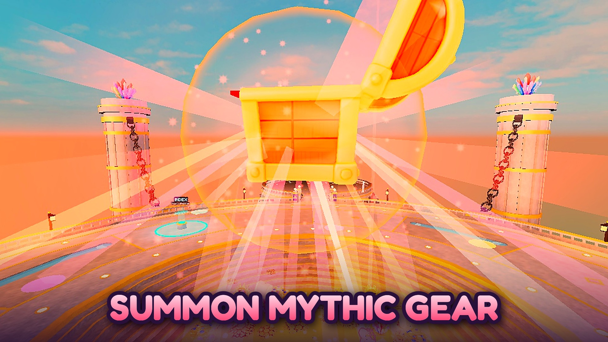
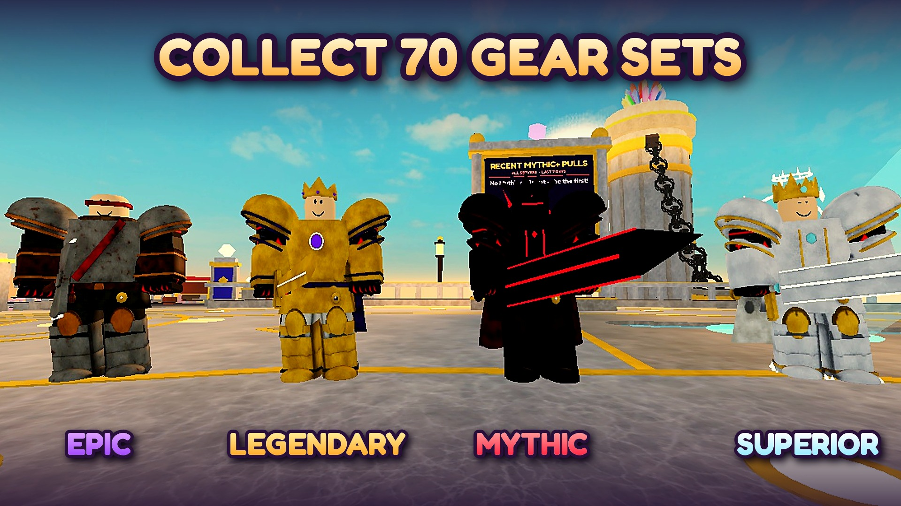
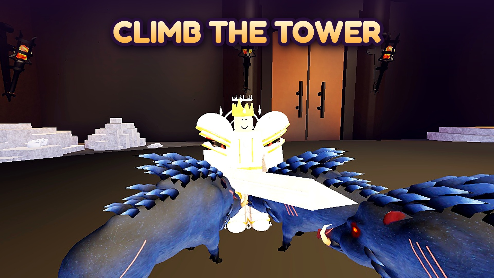
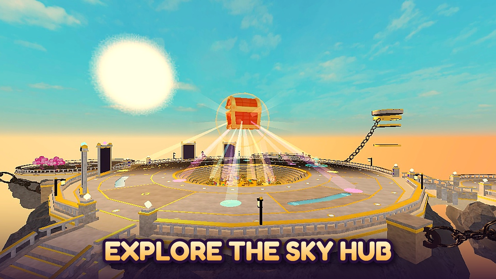
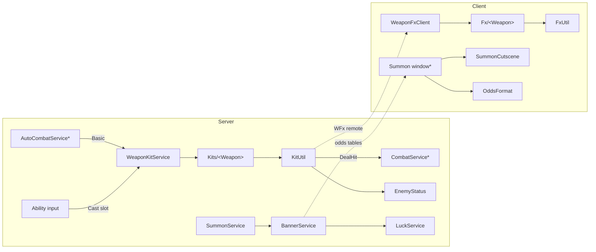

# Tower Conquest: gameplay code showcase

Selected server and client systems from **Tower Conquest**, a Roblox action roguelike I am building solo. Players climb a tower of procedurally assembled floors, collect gear from 73 sets, and unlock signature weapons with their own abilities and effects.

> **Status:** gameplay complete and in private testing. A public release follows once the remaining weapon and gear designs are finished.
>
> This repository is a **curated excerpt**, not the full game. It does not run on its own: it depends on modules that stay private (combat core, stats, enemy AI, inventory, saves, UI).

| | |
|---|---|
|  |  |
|  |  |

## What's in here

| System | Files | What it shows |
|---|---|---|
| Signature weapon framework | [`src/server/WeaponKits`](src/server/WeaponKits) | A plug-in contract for weapon kits (basic combo, 2 skills, ultimate, passive, dash hooks, stat mods), per-run state, and one shared damage pipeline |
| Two weapon kits | [`Kits/SevenVerities.lua`](src/server/WeaponKits/Kits/SevenVerities.lua), [`Kits/ThornOfTheAxis.lua`](src/server/WeaponKits/Kits/ThornOfTheAxis.lua) | 4-step combos, a steerable laser, summoned creatures that pull enemy aggro, a freeze-time ultimate |
| Status effects | [`EnemyStatus.lua`](src/server/WeaponKits/EnemyStatus.lua) | Freeze and slow with "strongest wins, same id refreshes" rules; animations paused on the server so the freeze replicates |
| Client effects | [`src/shared/WeaponKits/Fx`](src/shared/WeaponKits/Fx), [`src/client`](src/client) | A client-only VFX toolkit (sprites, rings, bursts, afterimages, camera shake), per-weapon effect modules, and a hit-combo counter |
| Summon (gacha) system | [`SummonService`](src/server/DungeonSystem/SummonService.lua), [`BannerService`](src/server/Progression/BannerService.lua), [`LuckService`](src/server/Progression/LuckService.lua) | Two banners, pity, luck multipliers, duplicate refunds, and odds built from the same tables the rolls use |
| Odds disclosure | [`OddsFormat.lua`](src/shared/OddsFormat.lua) | Percentages formatted to meet Roblox's paid random items policy |
| Summon cutscene | [`SummonCutscene.lua`](src/shared/SummonPlaza/Fx/SummonCutscene.lua) | A tiered camera cinematic: a falling star per pull, with a different ending for each rarity tier |
| Test arena | [`WeaponTestArena.server.lua`](src/server/WeaponKits/WeaponTestArena.server.lua) | A Studio-only arena: training dummies, attacker waves, and hot reloading of kit code |
| Animation tooling | [`tools/animation`](tools/animation) | R15 animations written as data, previewed with forward kinematics in Edit mode and exported as KeyframeSequences; a solver for arm angles that hold a weapon |

## Architecture

`*` = a module that is not included in this repository.

## Design decisions

- **One damage pipeline.** Kits never calculate damage themselves. `KitUtil.Hit` sends every hit through `CombatService.DealHit`, so crits, elements, defenses and damage numbers behave the same for every weapon.
- **The server decides, the client draws.** Kits run on the server and broadcast effect events (`KitUtil.Fx`). Each client draws them locally with `FxUtil`, so heavy VFX never replicate as instances.
- **No circular requires.** `CombatService` requires `WeaponKitService`, so the kits reach it back through a service registry, not `require`.
- **The odds shown are the odds rolled.** `BannerService.Describe` builds the odds screen from the same weight tables the rolls use, so the two can't drift apart.
- **Per-run state.** Kit state (stacks, cooldown boosts, summons) is keyed to the current run and dropped when the run ends, so buffs never leak into the lobby.
- **Typed Luau.** Gameplay modules use `--!strict`.

## How it was built

I wrote the design specs (weapon abilities, numbers, visuals) and drove development with an AI coding agent (Claude Code) connected to Roblox Studio and Blender over MCP. I reviewed and play-tested every change in Studio. In the kit specs, `[AI]` marks values the design doc left open, which were chosen during implementation.

The 3D models (bosses, weapons, gear) come from a Python/Blender pipeline: see [roblox-asset-pipeline](https://github.com/AtillaBenligil/roblox-asset-pipeline).

## License

Copyright © 2026 Atilla Halil Benligil. All rights reserved. The code is shared for portfolio review only; see [LICENSE](LICENSE).
